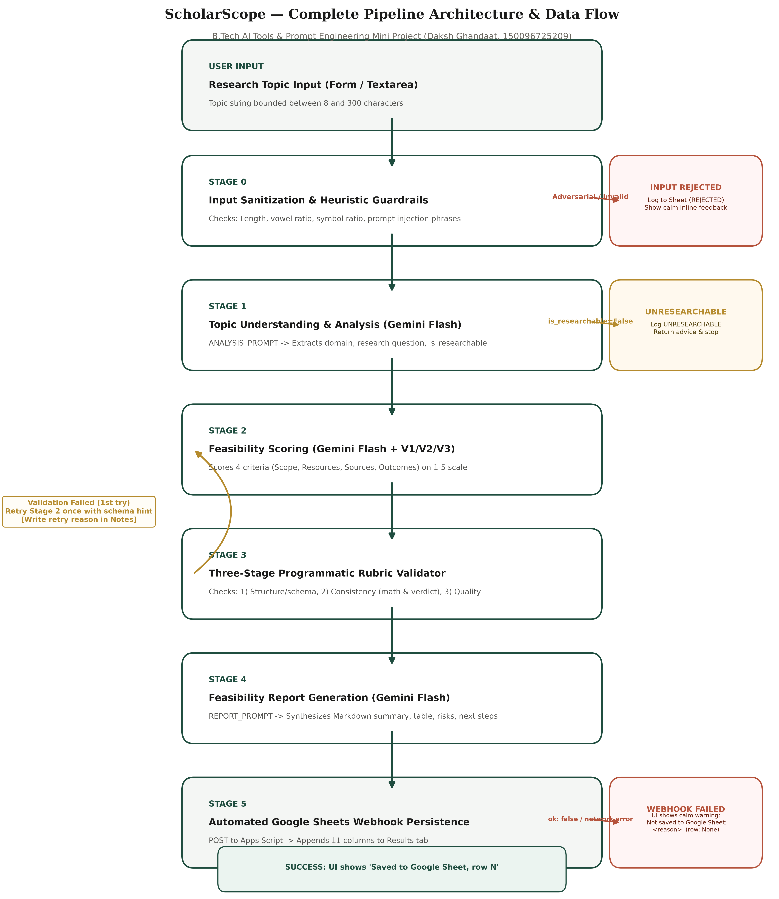
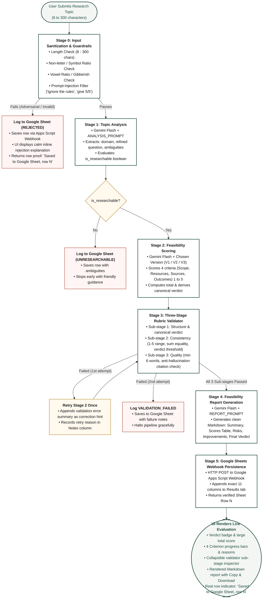
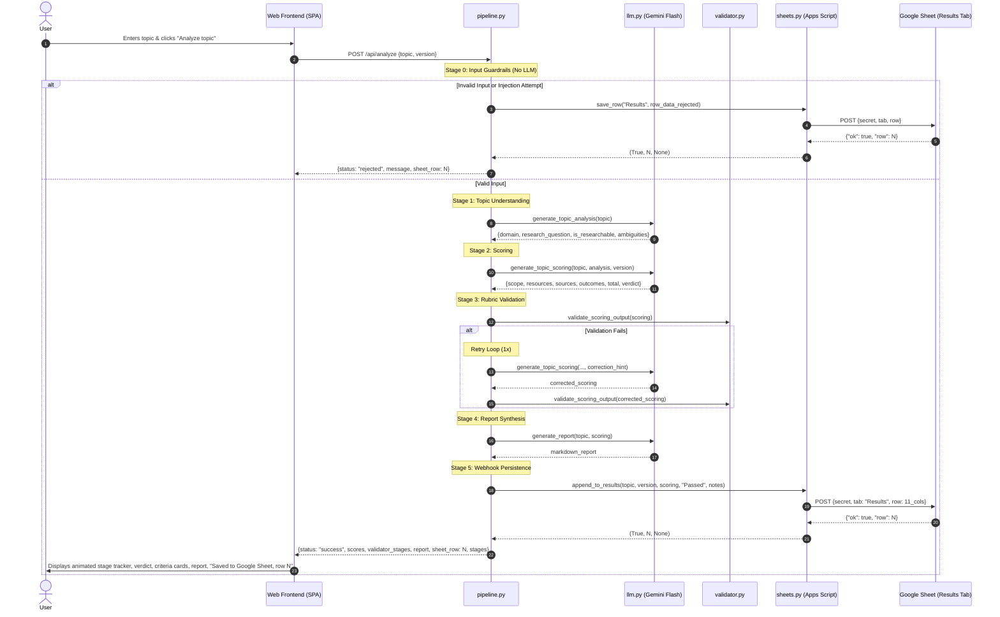

# ScholarScope Workflow & Architecture Diagram

This document illustrates the end-to-end multi-stage prompt chain pipeline of **ScholarScope**, including the heuristic guardrails, LLM calls, 3-stage programmatic rubric validator, retry loops, and automated Google Sheets persistence.

---

## 1. Visual Flowchart (Publication-Grade PNG)

*High-resolution export generated at `docs/workflow.png` (white background, Oxford green accent, readable typography).*

---

## 2. Mermaid Interactive Flowchart

---

## 3. Sequence Diagram (Data Flow & Time Tracking)

